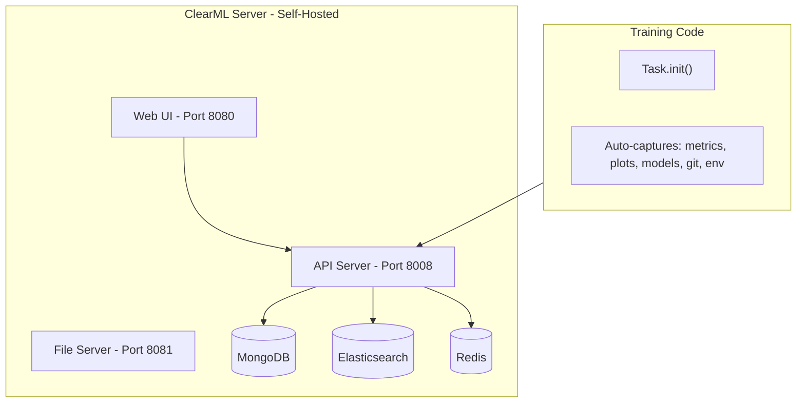
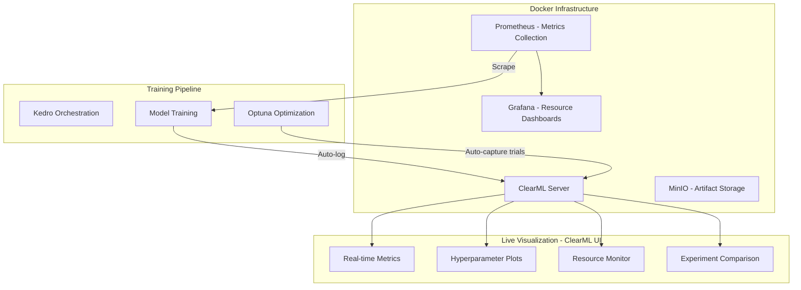

# Modern ML Visualization Platform Options

## Top 3 Self-Hosted Options Compared

### Option 1: ClearML (Recommended for Full Platform)

**Best for**: Complete MLOps replacement with zero-code automatic logging


| Feature               | Rating    | Notes                             |
| --------------------- | --------- | --------------------------------- |
| Live training metrics | Excellent | Real-time updating charts         |
| Hyperparameter viz    | Excellent | Native Optuna integration         |
| Experiment comparison | Excellent | Side-by-side with diff            |
| Resource monitoring   | Excellent | GPU/CPU/Memory tracking           |
| UI modernness         | Modern    | Clean, responsive dashboard       |
| Self-hosted           | Yes       | Docker Compose deployment         |
| Code changes needed   | Minimal   | Auto-logging captures most things |


**Killer features**:

- **Zero-code integration**: Add `from clearml import Task; Task.init()` and it auto-captures everything
- **Captures Optuna**: Automatically logs all trials, hyperparameters, and plots
- **System monitoring**: Built-in GPU/CPU/memory tracking per experiment
- **Pipelines**: Visual DAG editor for ML workflows
- **Model serving**: Built-in serving infrastructure

**Architecture**:




---

### Option 2: Aim (Recommended for Best Visualization)

**Best for**: Teams prioritizing visualization performance and modern UX


| Feature               | Rating      | Notes                       |
| --------------------- | ----------- | --------------------------- |
| Live training metrics | Excellent   | Fastest real-time updates   |
| Hyperparameter viz    | Good        | Via integrations            |
| Experiment comparison | Excellent   | Powerful grouping/filtering |
| Resource monitoring   | Good        | Via system metrics          |
| UI modernness         | Most Modern | Best-in-class React UI      |
| Self-hosted           | Yes         | Simple `aim up` command     |
| Code changes needed   | Low         | `aim.Run()` wrapper         |


**Killer features**:

- **Blazing fast**: Handles 1000s of experiments with instant search
- **Beautiful UI**: Most modern React-based interface
- **Lightweight**: Single command to start
- **Flexible queries**: Python SDK for custom visualizations

**Limitation**: Less "full platform" than ClearML - focused on experiment tracking

---

### Option 3: Enhanced MLflow + Grafana + Optuna Dashboard

**Best for**: Minimal migration, enhance existing stack


| Feature               | Rating    | Notes                        |
| --------------------- | --------- | ---------------------------- |
| Live training metrics | Good      | Via MLflow callbacks         |
| Hyperparameter viz    | Excellent | Optuna Dashboard             |
| Experiment comparison | Good      | MLflow UI                    |
| Resource monitoring   | Excellent | Grafana + Prometheus         |
| UI modernness         | Mixed     | Grafana modern, MLflow dated |
| Self-hosted           | Yes       | Already deployed             |
| Code changes needed   | Low       | Add dashboards               |


**Components to add**:

- **Grafana**: Resource monitoring dashboards
- **Optuna Dashboard**: Hyperparameter optimization visualization
- **MLflow callbacks**: Real-time metric logging

---

## Recommendation: ClearML

Given your requirements (full platform, self-hosted, all visualization aspects), **ClearML** is the best choice.

### Why ClearML over keeping MLflow:


| Aspect                 | MLflow           | ClearML                          |
| ---------------------- | ---------------- | -------------------------------- |
| Live training          | Manual callbacks | Automatic                        |
| Hyperparameter viz     | Basic            | Rich parallel coords, importance |
| Resource tracking      | None             | Built-in                         |
| Optuna integration     | Manual logging   | Auto-capture                     |
| Pipeline orchestration | None             | Visual builder                   |
| Model serving          | Basic            | Full infrastructure              |
| UI                     | Dated            | Modern                           |


### Migration Strategy

ClearML can **coexist with MLflow** during transition - it's not all-or-nothing.

---

## Implementation Architecture




---

## Files to Modify

### Core Integration


| File                                                                                                     | Changes                                     |
| -------------------------------------------------------------------------------------------------------- | ------------------------------------------- |
| `[docker-compose.yml](app-ml/docker-compose.yml)`                                                        | Add ClearML server services                 |
| `[pyproject.toml](app-ml/pyproject.toml)`                                                                | Add `clearml>=1.14.0`                       |
| `[dags/airflow_dag_enhanced.py](app-ml/dags/airflow_dag_enhanced.py)`                                    | Add `Task.init()` to training tasks         |
| `[pipelines/demand_modeling/nodes.py](app-ml/src/demand_forecasting/pipelines/demand_modeling/nodes.py)` | Add ClearML logging                         |
| Training scripts                                                                                         | Add `from clearml import Task; Task.init()` |


### Integration Code Example

```python
# In any training node - that's it!
from clearml import Task

def train_catboost_model(X_train, y_train, params):
    # Auto-captures everything: metrics, model, git, env, hardware
    task = Task.init(project_name="demand_forecasting", task_name="catboost_training")
    
    # Your existing training code - unchanged
    model = CatBoostRegressor(**params)
    model.fit(X_train, y_train, eval_set=[(X_test, y_test)], verbose=100)
    
    # ClearML auto-captures:
    # - All logged metrics
    # - Model artifacts
    # - Git commit
    # - Environment
    # - Hardware utilization
    # - Optuna trials (if using)
    
    return model
```

### Optuna Integration (Automatic)

```python
# ClearML auto-captures Optuna studies
import optuna
from clearml import Task

task = Task.init(project_name="demand_forecasting", task_name="hyperopt")

def objective(trial):
    params = {
        "learning_rate": trial.suggest_float("lr", 0.01, 0.3),
        "depth": trial.suggest_int("depth", 4, 10),
    }
    # ClearML captures all trials automatically
    return train_and_evaluate(params)

study = optuna.create_study()
study.optimize(objective, n_trials=100)
# All trials visible in ClearML UI with parallel coordinates, importance plots
```

---

## Docker Compose Addition

```yaml
# Add to docker-compose.yml
services:
  clearml-apiserver:
    image: allegroai/clearml:latest
    ports:
      - "8008:8008"
    depends_on:
      - clearml-mongo
      - clearml-elastic
      - clearml-redis
    environment:
      - CLEARML_HOST_IP=${CLEARML_HOST_IP:-localhost}
    
  clearml-webserver:
    image: allegroai/clearml:latest
    ports:
      - "8080:8080"  # Main UI
    
  clearml-fileserver:
    image: allegroai/clearml:latest
    ports:
      - "8081:8081"
    
  clearml-mongo:
    image: mongo:4.4
    
  clearml-elastic:
    image: elasticsearch:7.17.0
    
  clearml-redis:
    image: redis:6.0
```

---

## What About Evidently?

**Evidently still has a role** - use it for:

- Production data drift monitoring (ClearML doesn't do this)
- Model performance degradation detection
- Data quality reports

**Combined architecture**:

- **ClearML**: Training visualization, experiments, hyperparameters
- **Evidently**: Production monitoring and drift detection
- **Grafana**: Infrastructure/resource dashboards

---

## Quick Comparison Summary


| Requirement             | ClearML | Aim   | MLflow+Grafana | Evidently |
| ----------------------- | ------- | ----- | -------------- | --------- |
| Live training metrics   | Yes     | Yes   | Partial        | No        |
| Hyperparameter viz      | Yes     | Yes   | Partial        | No        |
| Experiment comparison   | Yes     | Best  | Yes            | No        |
| Resource monitoring     | Yes     | Basic | Yes (Grafana)  | No        |
| Data drift              | No      | No    | No             | Yes       |
| Model performance drift | No      | No    | No             | Yes       |
| Production monitoring   | No      | No    | No             | Yes       |
| Self-hosted             | Yes     | Yes   | Yes            | Yes       |


---

## Recommended Stack

```
Training Phase:     ClearML (experiments, hyperparameters, resources)
Production Phase:   Evidently (drift, data quality, model degradation)
Infrastructure:     Grafana + Prometheus (system metrics)
Orchestration:      Kedro + Airflow (keep existing)
```

